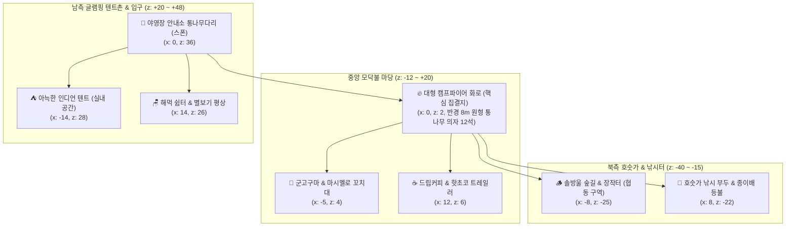

# 🦫 『카피바라 & 리트리버 모닥불 야영장 : 유유원(悠悠院)』 마스터 기획서 (v1.0)

> **한 줄 정의**: *"타닥타닥 장작 타는 소리와 호숫가 풀벌레 소리, 세상에서 가장 느긋한 동물들과 말없이 둘러앉아 불멍하고 칼림바를 연주하는 온라인 감성 야영장"*

본 기획서는 `sansatemple.com`(산사)의 **역공학 데이터(카메라 댐핑, 3중 물리 사운드 감쇠, 룸 샤딩, 비언어적 리추얼)**를 기반으로, 캠핑·불멍·동물 친화 감성을 극대화한 **기획안 B (유유원)**의 마스터 설계 문서입니다.

---

## 1. 서비스 정체성 및 감성 포지셔닝

### 1.1 왜 ‘카피바라 & 리트리버’인가?
1. **친화력의 상징 (무해함의 극치)**: 카피바라는 어떤 동물(악어, 원숭이, 오리)과도 평화롭게 어울리는 ‘친화력 만렙’ 동물입니다. 여기에 언제나 꼬리를 흔들며 환영하는 골든 리트리버가 더해져, 낯선 방문자끼리도 말없이 따뜻한 유대감을 느낄 수 있습니다.
2. **불멍(Bonfire Rest)의 치유력**: 산사의 법당 중심 구조를 **대형 모닥불 화로**로 전환하여, 중앙에 모여 앉아 장작이 타들어가는 불꽃과 불씨(`PointLight` 깜빡임)를 바라보며 사색할 수 있습니다.
3. **불협화음 제로 앰비언트 합주**: 산사의 108염주/목탁을 5음계(**펜타토닉 칼림바 & 하모니카**)로 발전시켜, 누가 어떤 음을 눌러도 항상 아름다운 화음이 완성되는 즉흥 잼(Jam) 세션을 제공합니다.

### 1.2 코어 유저 플로우

---

## 2. 월드 레이아웃 및 공간 설계 (`/api/village-map` 매핑)

중심 구역 반경 12m 내에 모닥불과 통나무 의자가 원형으로 배치되고, 외곽으로 글램핑 텐트, 낚시 부두, 솔방울 숲길이 이어집니다.

### 2.1 7대 주요 구역 명세표

| 구역 ID | 구역 명칭 | 중심 좌표 `(x, z)` | 특화 인터랙션 | 사운드 믹스 |
| :--- | :--- | :---: | :--- | :--- |
| **`bonfire_plaza`** | **대형 모닥불 광장** | `(0, 2)` | 통나무 의자 착석, 불멍, 칼림바 합주 | 장작 타는 소리 (거리 감쇠 12m) |
| **`roasting_post`** | 마시멜로/고구마 화덕 | `(-5, 4)` | 꼬치 굽기 대기열(`plantedAt`) 후 옆 사람 나눔 | 달콤한 자글거림 효과음 |
| **`glamping_tent`** | 감성 인디언 텐트 | `(-14, 28)` | 실내 진입(`indoor=1`), 램프 켜기, 엎드려 자기 | 텐트 캔버스 펄럭임, 빗소리/바람 감쇠 |
| **`lake_dock`** | 달빛 호수 낚시터 | `(8, -22)` | 물가 멍때리기, 소원 종이배 등불 띄우기 | 잔잔한 호수 물결(`5.4s` 루프) |
| **`pine_forest`** | **솔방울 숲길** | `(-8, -25)` | 바닥 솔방울 주워 모닥불에 넣기 (화력 유지) | 낙엽/흙 밟는 바스락 발자국 |
| **`cafe_trailer`** | 핫초코 & 드립커피 | `(12, 6)` | 타인에게 따뜻한 코코아 선물(`무소유`), 텀블러 | 김 서리는 컵, 온기 오라 |
| **`hammock_grove`** | 해먹 & 별자리 평상 | `(14, 26)` | 해먹 누워 밤하늘 보기, 폴라로이드 캡처 | 풀벌레(`night.mp3`) & 부엉이 |

---

## 3. 동물 아바타 & 애니메이션 상태 머신

### 3.1 4종 시그니처 동물 아바타
1. **카피바라 (Capybara)**:
   * 둥글둥글하고 무심한 표정, 머리 위에 **감귤/온천 수건/새**를 얹고 다님.
   * 이동: 느긋하고 묵직한 4족 보행. 정지: 그대로 엎드려 멍때리기.
2. **골든 리트리버 (Golden Retriever)**:
   * 풍성한 털과 끊임없이 살랑거리는 꼬리, 반짝이는 눈망울.
   * 이동: 경쾌한 총총걸음. 정지: 꼬리를 흔들며 헥헥 웃기.
3. **레서판다 (Red Panda)**:
   * 줄무늬 통통한 꼬리와 호기심 많은 귀.
   * 액션: 깜짝 놀라 두 앞발을 번쩍 드는 **만세 포즈** 인사!
4. **뚱뚱한 오리 (Chubby Duck)**:
   * 샛노란 부리와 뒤뚱뒤뚱 뒤뚱 보행, 물가에서 유유히 헤엄침.

### 3.2 킬러 인터랙션: 『카피바라 기차 산책』 (산사 pagodaWalk 확장)
* **메커니즘**:
  * 걷고 있는 다른 동물 뒤 `1.2m` 이내로 다가가 `T` 키나 화면의 **[기차 타기]** 버튼을 누르면 발동.
  * 앞선 동물과의 거리를 유지하며 자동으로 줄지어 이동하는 **꼬리물기 팔로우(Follow) 모드**.
  * 최대 8마리까지 줄줄이 연결되어 모닥불 둘레나 호숫가를 느긋하게 행진(SNS 짤 생성 최적화).
  * 언제든 방향키(`WASD`)를 누르면 자연스럽게 대열에서 이탈.

---

## 4. 리추얼 & 감성 시스템 상세

### 4.1 불멍 & 솔방울 보태기 (산사 construction 기와 불사 대체)
* **목표**: 야영장의 모닥불 수온/온기를 `100%`로 유지하기.
* **진행 플로우**:
  1. 솔방울 숲길(`pine_forest`) 바닥에 스폰된 커다란 솔방울을 앞발이나 입으로 줍기(`take`).
  2. 중앙 모닥불 화로로 이동해 솔방울을 던져 넣기(`drop`).
  3. 솔방울이 타오르며 경쾌한 ‘타닥-!’ 소리와 함께 불꽃 스파크 파티클이 솟구치고, 모닥불 `PointLight` 밝기와 온기 반경 상승.

### 4.2 즉흥 펜타토닉 칼림바 합주 (산사 moktak/beads 대체)
* **원리**: 5개 음(`도, 레, 미, 솔, 라` - C5, D5, E5, G5, A5)만 배정된 칼림바 건반 패드.
* **특징**:
  * 여러 방문자가 각자 건반을 난타해도 불협화음이 발생하지 않고 동화 같은 배경음악으로 어우러짐.
  * Web Audio의 `ConvolverNode` 1.7초 울림을 적용하여 청아한 쇠막대 공명음 연출.

### 4.3 마시멜로 굽기 & 나눔 (산사 incense 향 올리기 대체)
* 꼬치에 마시멜로를 꽂아 모닥불에 대고 있으면 `5초`에 걸쳐 노릇노릇하게 구워짐.
* 잘 구워진 마시멜로를 주변 통나무에 앉아 있는 다른 동물에게 건네주면, 상대방 머리 위에 행복한 하트 이모지와 따뜻한 분홍빛 온기(`afterglow`)가 피어오름.

---

## 5. 엔지니어링 & 사운드 파라미터 명세

### 5.1 카메라 스펙 (모닥불 중심 조망 최적화)
* **기본 FOV**: 데스크톱 **`62°`** / 모바일 세로 **`66°`**
* **기본 거리 (`distance`)**: **`3.2m`** (통나무 의자에 앉았을 때 모닥불 불꽃과 맞은편 동물들의 표정이 완벽히 프레임에 들어오는 황금 거리)
* **부각 (`Elevation`)**: 통나무 의자 착석 시 수평에 가까운 **`5.2°`**로 자동 전환되어 캠프파이어 맞은편 친구들과 눈높이를 맞춤.

### 5.2 모닥불 입체 사운드 감쇠 수식 (`mixBonfireSound`)
산사의 범종 물리 감쇠 수식을 장작불 ASMR에 맞게 재구성:

$$d = \text{모닥불과의 거리 } [0, 14\text{m}]$$

$$\text{Gain}_{\text{fire}}(d) = 0.28 \times \left(1 - \frac{\text{clamp}(d, 0, 14)}{14}\right)^{1.85}$$

$$f_{\text{LPF}}(d) = 1200 + \frac{6800}{1 + (d / 4)^{1.2}} \text{ [Hz]}$$

* **가까울 때 ($d \le 2\text{m}$)**: 장작 파열음(`Bandpass 2600Hz` 스파크 클릭)과 타오르는 중저역(`220Hz`)이 귓가에 생생하게 들림.
* **멀어질 때 ($d \to 14\text{m}$)**: 고역이 먼저 감쇠되어 먹먹한 장작 소리로 바뀌고, 호수 물결과 풀벌레 소리가 배경을 채움.

### 5.3 조명 연출 (노을빛 $\to$ 별빛 밤)
* **황혼 노을 (`dusk`)**: 태양광 `#ff8c5a` (낮은 각도 18° 사광), 하늘 `#3a284c` $\to$ `#f99d68` 그라데이션, 모닥불과 텐트 랜턴이 하나둘 켜짐.
* **모닥불 점광원 (`PointLight`)**: 색상 `#ff7b2b`, 조도 `2.4`, 반경 `14m`, 매 프레임 `Math.sin(time * 12) * 0.15`로 미세하게 깜빡이며 동물들의 얼굴에 일렁이는 그림자 형성.

---

## 6. 개발 단계별 마일스톤

1. **Step 1: 기획 확정**: 사용자 피드백 반영 및 주요 의사결정.
2. **Step 2: 코어 프로토타입 구축 (`c:\jun\REA\camp-bonfire`)**:
   * Three.js r180 모닥불 파티클, 통나무 링, 호숫가 지형.
   * 카피바라 & 리트리버 아바타 모델링(절차적/로우폴리) 및 4족 보행.
   * Web Audio 모닥불 장작 타는 소리(노이즈 + 랜덤 스파크 클릭) & 5음계 칼림바.
3. **Step 3: 상호작용 및 UI 완성**:
   * 카피바라 기차 산책, 솔방울 줍기, 마시멜로 굽기, 텐트 실내 진입.
4. **Step 4: 빌드 및 시각적 검증**.
