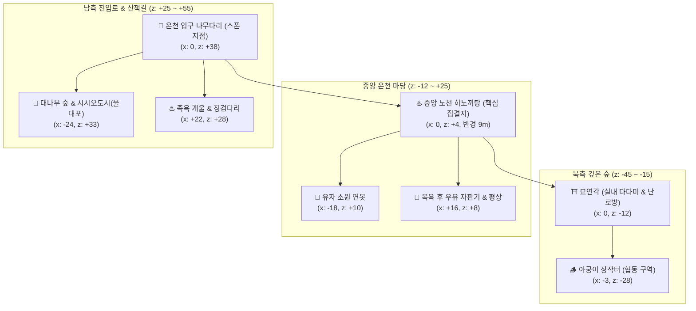

# 🐾 『고양이 온천 여관 : 묘유원(猫湯院)』 마스터 기획서 (v1.0)

> **한 줄 정의**: *"김이 모락모락 나는 눈 덮인 삼나무 숲속 노천탕, 말없이 같이 몸을 담그고 골골송을 듣는 온라인 고양이 온천"*

본 기획서는 `sansatemple.com`(산사) 역공학 분석에서 검증된 **비언어적 공존(Non-verbal Co-presence) 아키텍처**와 **시청각 피로도 제로(Zero-Fatigue) 엔진 파라미터**를 1:1로 계승·변주하여 즉시 프로토타이핑 및 프로덕션 개발이 가능하도록 설계한 상세 기획서입니다.

---

## 1. 서비스 정체성 및 핵심 UX 원칙

### 1.1 왜 ‘고양이 온천’인가?
1. **비언어적 당위성**: 고양이들은 원래 말없이 같은 공간에 모여서 각자 식빵을 굽거나 눈을 감고 쉽니다. 채팅창이 없는 시스템적 제약이 오히려 **"고양이답다"**는 완벽한 개연성으로 작동합니다.
2. **시각·청각적 쾌감의 결합**: 하얀 눈이 쌓인 바위(`stone`/`rock`), 따뜻한 히노끼 나무 욕조(`wood`), 모락모락 피어오르는 수증기, 졸졸 흐르는 온천수와 나른한 **골골송(Purring)**은 웹 브라우저에서 구현할 수 있는 최고의 ASMR 조합입니다.
3. **강력한 바이럴(짤 생성) 포인트**: 머리 위에 **접은 흰 수건**이나 **노란 유자**를 올린 통통한 고양이 20마리가 노천탕에 옹기종기 모여 앉아 있는 화면은 그 자체로 SNS 공유 욕구를 자극합니다.

### 1.2 코어 유저 루프 (Core Loop)

---

## 2. 월드 공간 레이아웃 및 좌표 설계 (`/api/village-map` 대응)

산사의 월드 경계(`핵심 구역 ±60m`, `원경 산세 ±240m`)와 충돌체(`colliders`) 구조를 그대로 활용하며, 중심 법당(`청연당`) 자리에 **메인 노천 히노끼탕(`온유당`)**과 실내 다다미 쉼터(`묘연각`)를 배치합니다.

### 2.1 8대 주요 구역 및 카메라/사운드 매핑표

| 구역 ID (`space`) | 구역 명칭 | 중심 좌표 `(x, z)` | 바닥 재질 (`footstep`) | 구역 특화 기능 및 사운드 연동 |
| :--- | :--- | :---: | :---: | :--- |
| **`entrance`** | 온천 입구 나무다리 | `(0, 38)` | `wood` | 초기 스폰 지점(`h0`), 방문묘 환영 표지판 |
| **`main_bath`** | **노천 히노끼탕 (중앙)** | `(0, 4)` | `stone` / `water` | 입욕 시 머리 위 **수건/유자** 자동 생성, **집단 골골송** 활성 |
| **`tatami_hall`** | **묘연각 (실내 난로방)** | `(0, -12)` | `wood` (`indoor=1`) | 실외 환경음 `32%`로 감쇠, 화로 장작 타는 소리 & 방석 식빵 굽기 |
| **`yuzu_pond`** | 소원 유자탕 | `(-18, 10)` | `stone` | 소원 메시지가 적힌 유자 띄우기 및 클릭해 읽어보기 (`lanternYard` 대체) |
| **`bamboo_shishi`** | 대나무 숲 시시오도시 | `(-24.3, 33)` | `dirt` | 클릭 시 대나무 물대포 타격음(`hearingDistance: 12m`) |
| **`firewood_yard`** | **아궁이 장작터** | `(-3, -28)` | `dirt` / `stone` | 앞치마 두건 쓰고 장작 나르기 (`construction` 협동 이벤트) |
| **`milk_booth`** | **우유 자판기 & 평상** | `(16, 8)` | `wood` | 병우유 뽑기(`무소유`/`풀소유`/`배달`), 평상 착석 후 폴라로이드 촬영 |
| **`foot_stream`** | 온천수 개울 산책로 | `(22, 28)` | `stone` | 거리 감쇠(`od = 9m`) 기반 온천수 흐르는 소리 & 김 서린 바위 |

---

## 3. 고양이 아바타 & 애니메이션 상태 머신

### 3.1 아바타 바리에이션 (드로우콜 최적화)
* **단일 리깅 메시 (`cat.glb` + 원거리 `cat-remote-lod.glb`)**:
  * 산사의 `k3` 크라우드 배칭(`EXT_color_buffer_float` 본 텍스처 베이킹)을 그대로 사용하기 위해 지오메트리는 1종으로 통일합니다.
  * 입장 시 또는 프로필에서 **6종 코트 패턴** 선택:
    1. `치즈태비` (`#e69c45` / `#f5e6d3`)
    2. `삼색이` (`#f4f1ea` + `#d97925` + `#33312e`)
    3. `턱시도` (`#262628` + `#f5f5f7` 흰 양말/가슴팍)
    4. `고등어태비` (`#7d8085` + `#3d4045`)
    5. `깜장이` (`#222326` + 노란 눈 `#f2c94c`)
    6. `크림시클` (`#f3dfc1`)

### 3.2 애니메이션 및 상태 머신 (`mode` & `gesture`)

| 상태 (`mode` / 액션) | 산사 원본 대응 | 동작 및 타이밍 상세 |
| :--- | :--- | :--- |
| **`walk` (아장아장 걷기)** | `walk` (`speed: 2.405 m/s`) | 네 발 보행(또는 2족 아장 보행 선택 가능), 이동 시 꼬리가 좌우로 살랑거림 |
| **`greet` (꼬리/귀 인사)** | `greet` (합장 인사) | 멈춰 서서 귀를 쫑긋 세우고 꼬리를 물음표 모양으로 흔들며 짧은 `"야옹~"` / `"냐아"` 효과음 |
| **`kneel` $\to$ `loaf` (식빵 굽기)** | `kneel` (방석 좌선) | 앞발을 가슴 아래로 쏙 넣고 눈을 지그시 감는 **식빵 굽기** 자세 |
| **`bow` $\to$ `knead` (꾹꾹이)** | `bow` (`4.8초` 주기: `prepare 0.55s`, `end 4.8s`) | 방석이나 탕 가장자리를 앞발로 꾹-꾹- 누르며 기분 좋게 기지개를 켜는 `4.8초` 루프 애니메이션 |
| **`soak` (노천탕 입욕)** | `gardenSeat` / `kneel` 확장 | 탕 안에 들어가 턱까지 물에 담근 채 눈을 감음. **30초 이상 입욕 유지 시 머리 위에 노란 유자 1개가 퐁! 하고 올라감** |
| **`carrying` (장작 운반)** | `construction` (`helmet` / `carrying`) | 머리에 **온천 체크 수건**을 두르고 등이나 앞발에 장작 1개비를 들고 나르는 포즈 |

---

## 4. 핵심 인터랙션 & 멀티플레이어 기능 명세

### 4.1 하단 액션 독 (Dock 4종 도구)
1. **🐾 코 인사 (`합장 인사` 대체)**: 주변 고양이에게 귀를 쫑긋하며 인사.
2. **🍞 꾹꾹이 & 식빵 (`절하기` 대체)**: 제자리 또는 가까운 방석/탕 자리로 이동해 4.8초 주기로 꾹꾹이 수행 (연속 수행 시 카운트 누적).
3. **🎋 대나무 실로폰 (`목탁` 대체)**: 클릭하거나 키보드를 누를 때마다 맑은 대나무 물방울/실로폰 소리가 나는 수동 악기.
4. **🧶 털실 코인 굴리기 (`염주 돌리기` 대체)**: 화면에 큰 털실 뭉치(또는 나무 구슬) 모달(`FOV 38°`)이 열리고, 마우스 휠이나 스와이프로 굴리며 잡념을 비우는 108 카운터.

### 4.2 경내 주요 오브젝트 인터랙션
1. **🍊 소원 유자 띄우기 (`소원 연등` 대체)**:
   * 유자 바구니를 클릭하면 유자 색깔/잎사귀 모양(5종)을 고르고 소원 메시지(최대 40자)를 적어 유자탕에 띄움.
   * 물 위에 떠 있는 다른 방문자의 유자를 클릭하면 카메라가 유자로 줌인(`lanternView`)하며 소원 문구를 보여줌.
2. **🥚 온천 달걀 담그기 (`향 올리기` 대체)**:
   * 대기열(`incenseQueue`)을 통해 한 명씩 온천수 원천 바구니에 달걀을 담그는 의식(`approaching` $\to$ `offering` $\to$ `steaming`).
3. **🎋 대나무 시시오도시 (`범종` 대체)**:
   * 대나무 숲의 커다란 시시오도시를 당기면 물이 쏟아지며 청아한 **‘딱—!’** 소리와 함께 대나무 울림이 반경 `12m` 내 모든 방문자에게 거리 감쇠 수식(`mixVillageBell`)으로 전파됨 (쿨다운 `300초`).
4. **♨️ 온탕 둘레 돌기 (`탑돌이` 대체)**:
   * 노천탕 둘레 돌담길을 따라 다른 고양이들과 줄지어 일정한 속도로 꼬리를 흔들며 산책하는 모드(`pagodaWalk`).

### 4.3 협동 미니 이벤트: 『아궁이 장작 지피기』 (`construction` 대체)
* **스토리**: *"눈보라가 치는 날에도 온천물이 식지 않도록 함께 장작을 보태요."*
* **진행 플로우**:
  1. `equip`: 장작터 선반을 눌러 **체크무늬 목수건** 착용.
  2. `take`: 묘연각 뒤편 장작 더미에서 장작 1개비 집기.
  3. `drop`: 아궁이 입구에 장작 넣기 $\to$ 현재 서버(`묘유원 01`~`20`)의 장작 카운트(`tiles`) +1 및 온천 수증기 밀도 상승.
  4. 서버 목표치 달성 시 다른 서버로 온기를 나눠주는 `overflow` 모드 발동.

### 4.4 브랜드 콜라보 & 후원 시스템 (`CAFE25` & `공양미` 대체)
1. **🥛 목욕 후 병우유 자판기 (브랜드 스폰서십 확장 가능)**:
   * **무소유 (선물하기)**: 노천탕이나 평상에서 쉬고 있는 다른 고양이에게 **따뜻한 바나나우유 / 딸기우유 / 마따따비 차** 선물하기. 받은 고양이 주변에는 포근한 분홍빛 온기(`afterglow`)가 피어오름.
   * **풀소유 (25회 꾹꾹이 보상)**: 직접 **꾹꾹이 25회**를 마친 뒤 자판기에서 내 우유를 뽑아 마시고 평상 벤치에 앉아 쉬기(이때 참새 대신 **눈새(오목눈이/뱁새)** `seatBirds`가 날아와 옆에 앉음!).
   * **배달 (마음 전하기)**: 카카오톡/링크로 친구에게 김 서린 온천 엽서와 우유 보내기.
2. **🐟 간식캔(연어/츄르) 보태기 (`공양미 보태기` 후원 모달)**:
   * *"고양이들이 겨울에도 따뜻하게 몸을 녹일 수 있도록 장작값(서버비)을 보태주세요."* (토스뱅크 / 카카오페이 QR / Buy Me a Coffee 연동).

---

## 5. 엔진 핵심 파라미터 명세 (산사 역공학 수치 기반 튜닝)

### 5.1 카메라 & 뷰포트 파라미터 (`u4` & `h3`)
고양이 아바타는 동자승보다 키가 작고 둥글기 때문에, 카메라 거리를 좁히고 내려다보는 각도(Elevation)를 약간 높여 **아기자기한 디오라마 비율**을 만듭니다.

| 파라미터 | 산사 원본값 | **묘유원(고양이 온천) 설정값** | 설계 의도 |
| :--- | :--- | :--- | :--- |
| **FOV (가로 / 세로)** | `64°` / `68°` | **`60°` / `65°`** | 원근 왜곡을 한 단계 더 줄여 고양이 체형이 찌그러지지 않게 보존 |
| **기본 거리 (`distance`)** | `3.85m` (`2.2 ~ 14m`) | **`2.85m` (`1.8 ~ 11m`)** | 작은 고양이 아바타가 화면 중앙 하단에 존재감 있게 잡히도록 조정 |
| **카메라 높이 오프셋 ($a$)** | 가로 `1.88m` / 세로 `2.65m` | **가로 `1.45m` / 세로 `2.10m`** | 고양이 눈높이 기준 최적의 오버더숄더 고도 |
| **주시점 높이 오프셋 ($c$)** | 가로 `1.13m` / 세로 `0.85m` | **가로 `0.55m` / 세로 `0.45m`** | 전방 3m 지점 바닥/수면을 자연스럽게 응시 |
| **실효 내려다보는 각도** | 가로 `6.83°` / 세로 `15.27°` | **가로 `10.05°` / 세로 `16.40°`** | 노천탕 수면과 떠다니는 유자, 다른 고양이들의 정수리가 한눈에 들어오는 황금 각도 |
| **카메라 이동 감쇠** | `1 - exp(-dt * 7)` | **`1 - exp(-dt * 6.5)`** | 고양이 특유의 나른하고 부드러운 시선 이동 |

### 5.2 조명(Lighting) & 안개/수증기(Fog/Steam) 파라미터

| 구분 | 낮 (`day`, 설경 오후) | 밤 (`night`, 등불 켜진 노천탕) | 비고 |
| :--- | :--- | :--- | :--- |
| **`HemisphereLight` (`sky`)** | 상단 `#e4eef5` / 하단 `#b5aba0` 강도: 실외 **`0.82`**, 실내 **`0.60`** | 상단 `#8ea2c8` / 하단 `#6e6052` 강도: 실외 **`0.58`**, 실내 **`0.38`** | 눈 덮인 숲의 부드러운 하늘 반사광 |
| **`AmbientLight`** | `#f8efe6`, 강도 **`0.16`** | `#ebd0c4`, 강도 **`0.40`** | 낮에는 그림자 입체감 유지, 밤에는 은은한 시인성 확보 |
| **`DirectionalLight` (`sun`)** | `#fff3dc`, 강도 **`2.15`** 위치 `(-32, 36, 30)` | `#9fb8ec`, 강도 **`0.50`** | `PCFSoftShadowMap` (`2048` / `3072`), `normalBias: 0.075` |
| **노천탕 & 실내 `SpotLight`** | `#ffe0bd`, 강도 **`140`** ($480 \times 0.54^2$) | **`#ff9e3b` (따뜻한 호박색 등불)**, 강도 **`175`** | 밤에 노천탕 수면과 히노끼 욕조가 황금빛으로 빛나도록 연출 |
| **선형 안개 (`THREE.Fog`)** | `#bccad1`, `near: 65m`, `far: 185m` | `#252d42`, `near: 55m`, `far: 165m` | 산사(`95~232m`)보다 안개 거리를 당겨 아늑한 산속 분지 느낌 부여 |
| **노천탕 수증기 셰이더** | 수면(`r < 9m, y < 1.8m`) 위 `smoothstep` 기반 소프트 파티클 & 바닥 연무(`uSteamHaze: #eef4f6`) | 밤에는 등불 색을 받아 `#ffd8a8` 톤으로 수증기 산란 | 노천탕의 따뜻한 온기를 시각적으로 전달하는 핵심 장치 |

### 5.3 표면 재질 프로파일 (`Ox` & `Dx` 루마 정규화 PBR)
산사의 루마/채도 정규화 셰이더(`onBeforeCompile`)를 그대로 쓰되, 온천 테마에 맞춰 3개 재질(`hinoki`, `snow`, `water_stone`)을 튜닝합니다.

* **`hinoki` (히노끼 욕조 목재)**: `tint: "#d8be98"`, `roughness: 0.82`, `normal: 0.14`, `variation: 0.55`, `saturation: 0.45`, `gain: 1.12` (따뜻하고 매끈한 편백나무 질감)
* **`snow` (소복이 쌓인 눈)**: `tint: "#eff4f8"`, `roughness: 0.92`, `normal: 0.22`, `variation: 0.25`, `saturation: 0.15`, `gain: 1.08` (부드럽고 눈부시지 않은 설원)
* **`wet_stone` (온천탕 젖은 바위)**: `tint: "#7a7d78"`, `roughness: 0.58` (물기에 젖어 반사율이 높음), `normal: 0.42`, `env: 0.38`, `variation: 0.85`

### 5.4 Web Audio 믹싱 & 절차적 사운드 합성 스펙 (`m4` 엔진 개조)

1. **절차적 집단 골골송 합성기 (`createPurrSound` — 신규 킬러 기능)**:
   * **원리**: 노천탕 또는 난로방에서 식빵을 굽고 있는 주변 고양이 수($N \in [1, 8]$)에 따라 게인이 올라가는 절차적 저주파 합성음.
   * **오디오 노드 체인**:
     * 기본 진동: `26.5 Hz` 삼각파(`triangle`) + `53.0 Hz` 사인파(`sine`) + 핑크 노이즈(`Bandpass 180Hz, Q=1.2`).
     * 들숨·날숨 호흡 변조(LFO): `0.26 Hz` (**주기 3.85초** — 고양이의 평균 수면 호흡 주기) 오실레이터가 게인을 부드럽게 오르내리게 변조.
     * `Lowpass 220Hz` 통과 후 `ambientBus`로 연결 (실내나 탕 안에서만 거리 감쇠 $d \le 6\text{m}$로 들림).
2. **절차적 온천수 & 물방울 소리 (`createOnsenWater`)**:
   * 산사의 `createRiverSound` 5.4초 핑크 노이즈 루프를 개조하여 대나무 통에서 떨어지는 온천수 소리 구현:
     * 저역 물결(`380Hz`, 배속 `0.82x`, 게인 `0.55`) + 중역 졸졸거림(`980Hz`, 배속 `1.18x`, 게인 `0.32`) + 고역 기포음(`1850Hz`, 배속 `1.55x`, 게인 `0.08`).
   * **거리 감쇠**: 노천탕 및 개울로부터 거리 $d \in [0, 9\text{m}]$에 대해 $\text{Gain}(d) = 0.18 \times (1 - d/9)^2$.
3. **4채널 사운드 믹서 구성**:
   * **채널 1 (`환경음`, 기본 35%)**: 눈바람 소리 + 온천수 흐르는 소리 + 오목눈이 새소리(14~26초 주기).
   * **채널 2 (`골골송 & 온기`, 기본 30%)**: 고양이 골골송 + 묘연각 화로 장작 타는 소리 (`개인 골골송 듣기` / `함께 골골송 듣기` 토글).
   * **채널 3 (`효과음`, 기본 35%)**: 눈 밟는 뽀드득 발자국(`snow`), 나무 마루 발자국(`wood`), 물 첨벙거림(`water`), 시시오도시 타격음, 꾹꾹이/털실 소리.
   * **채널 4 (`백그라운드 재생`)**: 다른 창으로 작업할 때도 온천 ASMR과 골골송이 계속 재생되도록 `navigator.audioSession.type = "playback"` 유지.

---

## 6. 단계별 개발 계획 (Implementation Roadmap)

| 단계 | 목표 범위 | 주요 구현 내역 |
| :--- | :--- | :--- |
| **Phase 1 (코어 엔진 & 월드 MVP)** | 3D 온천 지형 + 카메라 + 조명/안개 + Web Audio 골골송/온천수 | • Three.js r180 씬, `FOV 60°/65°`, `distance 2.85m` 카메라 컨트롤러 • 히노끼 노천탕, 눈 덮인 마당, 유자 연못, 묘연각 기본 3D 지오메트리 및 루마 정규화 셰이더 • 절차적 온천수 + 바람 + 집단 골골송 Web Audio 믹서 구현 |
| **Phase 2 (아바타 & 리추얼 UI)** | 고양이 아바타 6종 + 하단 독 4대 액션 + 소원 유자 | • 고양이 이동/식빵 굽기/꾹꾹이/입욕(머리 위 유자·수건) 애니메이션 • 소원 유자 띄우기 모달, 대나무 시시오도시 타격, 털실 108 카운터 |
| **Phase 3 (멀티플레이어 & 협동)** | Web Worker + WebSocket 동기화 + 장작 지피기 + 우유 자판기 | • `presence-worker` 기반 20인 룸 동기화 및 충돌 판정 • 아궁이 장작 운반 협동 이벤트 및 목욕 후 병우유 자판기/폴라로이드 캡처 |
| **Phase 4 (모바일/PWA 폴리싱)** | Safari 뷰포트 보정 + 프레임 페이서 + 후원 모달 | • iOS Safari 블리드 보정, 30/15 FPS 적응형 페이서, 간식캔 후원 모달 |
