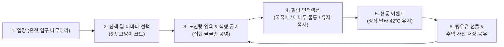
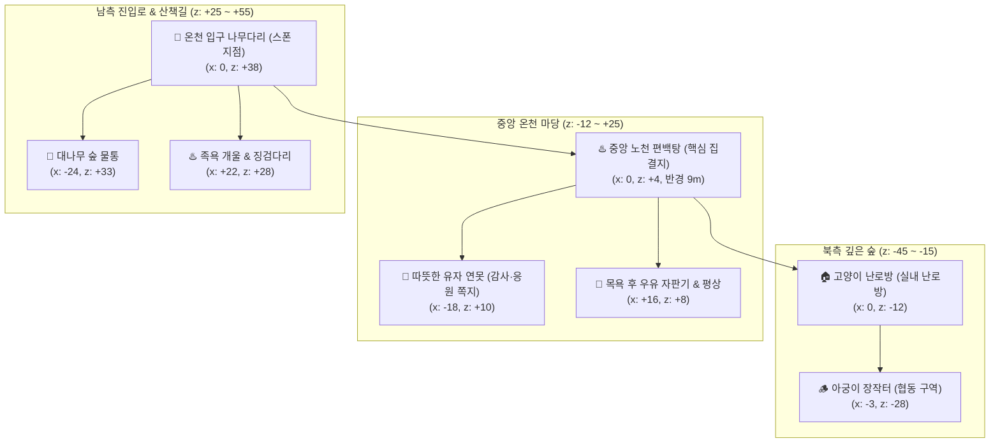

# 🐾 『고양이 온천 여관 : 묘유원(猫湯院)』 마스터 기획서 (v1.1)

> **한 줄 정의**: *"김이 모락모락 나는 눈 덮인 삼나무 숲속 노천탕, 말없이 같이 몸을 담그고 골골송을 들으며 쉼과 온기를 나누는 온라인 고양이 온천"*

본 기획서는 초기 기술 프로토타입(`HANDOFF.md` 참조)의 **비언어적 공존(Non-verbal Co-presence) 아키텍처**와 **시청각 피로도 제로(Zero-Fatigue) 엔진 파라미터**를 계승하되, **기복적·특정 종교 색채를 제거하고 건전한 안식·나눔·다인 접속 확장**을 반영하여 현행화한 상세 기획서입니다.

---

## 1. 서비스 정체성 및 핵심 UX 원칙

### 1.1 왜 ‘고양이 온천’인가?
1. **비언어적 당위성**: 고양이들은 원래 말없이 같은 공간에 모여서 각자 식빵을 굽거나 눈을 감고 쉽니다. 채팅창 없는 조용한 공존이 오히려 **"고양이답고 편안한 쉼"**이라는 개연성으로 작동합니다.
2. **시각·청각적 쾌감의 결합**: 하얀 눈이 쌓인 바위(`stone`/`rock`), 따뜻한 편백나무 욕조(`wood`), 모락모락 피어오르는 수증기, 졸졸 흐르는 온천수와 나른한 **골골송(Purring)**은 웹 브라우저에서 구현할 수 있는 최고의 ASMR 조합입니다.
3. **공감과 위로의 교제 포인트**: 머리 위에 **접은 흰 수건**이나 **노란 유자**를 올린 고양이들이 함께 온천을 즐기고, 서로에게 **감사·응원 유자 쪽지**와 **따뜻한 병우유**를 건네며 쉼을 나눕니다.

### 1.2 코어 유저 루프 (Core Loop)

---

## 2. 월드 공간 레이아웃 및 좌표 설계

핵심 구역(`±60m`)과 원경 산세(`±240m`) 및 충돌체(`colliders`) 구조를 기반으로, 중앙에 **메인 노천 편백탕**과 **실내 난로방(`고양이 난로방`)**을 배치합니다.

### 2.1 8대 주요 구역 및 카메라/사운드 매핑표

| 구역 ID (`space`) | 구역 명칭 | 중심 좌표 `(x, z)` | 바닥 재질 (`footstep`) | 구역 특화 기능 및 사운드 연동 |
| :--- | :--- | :---: | :---: | :--- |
| **`entrance`** | 온천 입구 나무다리 | `(0, 38)` | `wood` | 초기 스폰 지점, 방문 고양이 환영 진입로 |
| **`main_bath`** | **노천 편백탕 (중앙)** | `(0, 4)` | `stone` / `water` | 입욕 시 머리 위 **수건/유자** 자동 생성, **집단 골골송** 활성 |
| **`tatami_hall`** | **고양이 난로방 (실내 난로방)** | `(0, -12)` | `wood` (`indoor=1`) | 실외 환경음 감쇠, 화로 장작 타는 소리 & 방석 식빵 굽기 |
| **`yuzu_pond`** | 따뜻한 유자 연못 | `(-18, 10)` | `stone` | 감사·응원·안부 메시지가 담긴 유자 쪽지 띄우기 및 읽기 |
| **`bamboo_shishi`** | 대나무 숲 물통 | `(-24, 33)` | `dirt` | 클릭 시 맑은 대나무 물통 타격음(`hearingDistance: 12m`) |
| **`firewood_yard`** | **아궁이 장작터** | `(-3, -28)` | `dirt` / `stone` | 체크 수건 두르고 장작 나르기 (아궁이 화력 +1°C 협동 이벤트) |
| **`milk_booth`** | **우유 자판기 & 평상** | `(16, 8)` | `wood` | 25회 꾹꾹이 달성 내 우유 뽑기 / 주변 고양이 선물하기, 평상 휴식 & 추억 사진 촬영 |
| **`foot_stream`** | 족욕 개울 산책로 | `(22, 28)` | `stone` | 거리 감쇠(`od = 9m`) 기반 온천수 흐르는 소리 & 징검다리 산책 |

---

## 3. 고양이 아바타 & 애니메이션 상태 머신

### 3.1 아바타 바리에이션 (드로우콜 최적화)
* **단일 리깅 메시 (`cat.glb` + 원거리 `cat-remote-lod.glb`)**:
  * 산사의 `k3` 크라우드 배칭(`EXT_color_buffer_float` 본 텍스처 베이킹)을 그대로 사용하기 위해 지오메트리는 1종으로 통일합니다.
  * 입장 시 또는 프로필에서 **6종 코트 패턴** 선택:
    1. `치즈태비` (`#e69c45` / `#f5e6d3`)
    2. `삼색이` (`#f4f1ea` + `#d97925` + `#33312e`)
    3. `턱시도` (`#262628` + `#f5f5f7` 흰 양말/가슴팍)
    4. `고등어태비` (`#7d8085` + `#3d4045`)
    5. `깜장이` (`#222326` + 노란 눈 `#f2c94c`)
    6. `크림냥` (`#f3dfc1`)

### 3.2 애니메이션 및 상태 머신 (`mode` & `gesture`)

| 상태 (`mode` / 액션) | 동작 및 타이밍 상세 |
| :--- | :--- |
| **`walk` (아장아장 걷기)** | 네 발 보행(최대 속도 `2.4 m/s` 이상 부드러운 이동), 이동 시 꼬리가 좌우로 살랑거림 |
| **`greet` (꼬리/귀 인사)** | 멈춰 서서 귀를 쫑긋 세우고 꼬리를 흔들며 짧은 `"야옹~"` 효과음 |
| **`knead` $\to$ `loaf` (꾹꾹이 & 식빵 굽기)** | 앞발로 꾹-꾹- 누르며 기지개를 켠 뒤 앞발을 가슴 아래로 쏙 넣고 눈을 감는 휴식 자세 (`knead` 누적 카운트 증가) |
| **`soak` (노천탕 입욕)** | 탕 안에 들어가 턱까지 물에 담근 채 눈을 감음. 입욕 유지 시 머리 위 **수건/유자** 연출 |
| **`carrying` (장작 운반)** | 머리에 **체크무늬 온천 수건**을 두르고 장작 1개비를 들어 아궁이로 나르는 포즈 |

---

## 4. 핵심 인터랙션 & 멀티플레이어 기능 명세

### 4.1 하단 액션 독 (주요 액션)
1. **🐾 코 인사 (`G`)**: 주변 고양이에게 귀를 쫑긋하며 반갑게 인사.
2. **🍞 꾹꾹이 / 식빵 (`B`)**: 제자리 또는 가까운 방석/자리에서 꾹꾹이 수행 후 식빵 자세로 전환 (누적 횟수로 병우유 자판기 해금).
3. **♨️ 노천탕 입욕 (`E`)**: 노천탕으로 걸어가 몸을 담그고 휴식.
4. **🧶 털실 굴리기 (100 카운터)**: 큰 털실 뭉치 모달이 열리고 마우스 휠이나 드래그로 100바퀴를 감으며 차분히 쉬어가는 카운터 (특정 종교 상징 배제).
5. **🐈 산책 동행 (`T`, 혼잡 방지형)**: 최대 2마리의 여관 고양이가 `1.45m` 간격으로 뒤를 따라 산책(다인 접속 시 시야 혼잡을 막기 위한 상한 설계).
6. **🎋 대나무 실로폰 (`M`)**: C 메이저 5음계(도·레·미·솔·라)로 언제 눌러도 화음이 어우러지는 대나무 음계 연주.

### 4.2 주요 구역 오브젝트 인터랙션
1. **🍊 감사·응원 유자 띄우기**:
   * 유자 연못을 클릭하거나 근처에서 `F`를 누르면 5종 유자 색상을 고르고 **감사·안부·응원 메시지(최대 40자)**를 적어 연못에 띄움.
   * 물 위에 떠 있는 다른 방문자의 유자를 클릭하면 쪽지 내용을 함께 읽어보는 커뮤니티 나눔 공간으로 동작.
2. **🥚 온천 달걀 담그기**:
   * 노천탕 옆 온천 원천 바구니에 달걀을 담그고 김이 모락모락 오르는 반숙 체험 수행.
3. **🎋 대나무 물통 울리기**:
   * 대나무 숲 물통을 클릭하거나 `F`를 눌러 청아하고 맑은 대나무 물소리를 울림.

### 4.3 협동 미니 이벤트: 『아궁이 장작 지피기』
* **스토리**: *"눈보라가 치는 날에도 온천물이 식지 않도록 함께 장작을 보태요."*
* **진행 플로우**:
  1. `take`: 장작 더미를 클릭해 **체크무늬 온천 수건**을 두르고 장작 1개비 집기.
  2. `drop`: 옆 아궁이 입구에 장작 넣기 $\to$ 아궁이 불꽃이 살아나며 온천 온도 `+1°C (42°C 유지!)` 및 수증기 밀도 상승.
  3. 멀티플레이어 확장 시 서버 룸 공용 온도 게이지/아궁이 카운트와 동기화.

### 4.4 병우유 자판기 나눔 & 운영 후원 방향
1. **🥛 목욕 후 병우유 자판기**:
   * **주변 고양이에게 나눔 선물하기**: 노천탕이나 평상에서 쉬고 있는 주변 고양이에게 **따뜻한 바나나우유 / 딸기우유 / 흰우유 / 녹차우유** 선물하기 (받은 고양이 주변에 분홍빛 온기 피어오름).
   * **25회 꾹꾹이 달성 보상**: 직접 **꾹꾹이 25회**를 채운 뒤 자판기에서 내 병우유를 뽑아 마시고 원목 평상 벤치에 앉아 오목눈이(뱁새)와 함께 쉬기 + 추억 사진 저장.
2. **☕ 서버·운영비 자율 후원 (선택 확장)**:
   * *"따뜻한 온천 공간과 서버 운영을 응원해 주세요."* (향후 필요 시 투명한 운영 후원 링크 연동).

---

## 5. 엔진 핵심 파라미터 명세 (산사 역공학 수치 기반 튜닝)

### 5.1 카메라 & 뷰포트 파라미터 (`u4` & `h3`)
고양이 아바타는 동자승보다 키가 작고 둥글기 때문에, 카메라 거리를 좁히고 내려다보는 각도(Elevation)를 약간 높여 **아기자기한 디오라마 비율**을 만듭니다.

| 파라미터 | 산사 원본값 | **묘유원(고양이 온천) 설정값** | 설계 의도 |
| :--- | :--- | :--- | :--- |
| **FOV (가로 / 세로)** | `64°` / `68°` | **`60°` / `65°`** | 원근 왜곡을 한 단계 더 줄여 고양이 체형이 찌그러지지 않게 보존 |
| **기본 거리 (`distance`)** | `3.85m` (`2.2 ~ 14m`) | **`2.85m` (`1.8 ~ 11m`)** | 작은 고양이 아바타가 화면 중앙 하단에 존재감 있게 잡히도록 조정 |
| **카메라 높이 오프셋 ($a$)** | 가로 `1.88m` / 세로 `2.65m` | **가로 `1.45m` / 세로 `2.10m`** | 고양이 눈높이 기준 최적의 오버더숄더 고도 |
| **주시점 높이 오프셋 ($c$)** | 가로 `1.13m` / 세로 `0.85m` | **가로 `0.55m` / 세로 `0.45m`** | 전방 3m 지점 바닥/수면을 자연스럽게 응시 |
| **실효 내려다보는 각도** | 가로 `6.83°` / 세로 `15.27°` | **가로 `10.05°` / 세로 `16.40°`** | 노천탕 수면과 떠다니는 유자, 다른 고양이들의 정수리가 한눈에 들어오는 황금 각도 |
| **카메라 이동 감쇠** | `1 - exp(-dt * 7)` | **`1 - exp(-dt * 6.5)`** | 고양이 특유의 나른하고 부드러운 시선 이동 |

### 5.2 조명(Lighting) & 안개/수증기(Fog/Steam) 파라미터

| 구분 | 낮 (`day`, 설경 오후) | 밤 (`night`, 등불 켜진 노천탕) | 비고 |
| :--- | :--- | :--- | :--- |
| **`HemisphereLight` (`sky`)** | 상단 `#e4eef5` / 하단 `#b5aba0` 강도: 실외 **`0.82`**, 실내 **`0.60`** | 상단 `#8ea2c8` / 하단 `#6e6052` 강도: 실외 **`0.58`**, 실내 **`0.38`** | 눈 덮인 숲의 부드러운 하늘 반사광 |
| **`AmbientLight`** | `#f8efe6`, 강도 **`0.16`** | `#ebd0c4`, 강도 **`0.40`** | 낮에는 그림자 입체감 유지, 밤에는 은은한 시인성 확보 |
| **`DirectionalLight` (`sun`)** | `#fff3dc`, 강도 **`2.15`** 위치 `(-32, 36, 30)` | `#9fb8ec`, 강도 **`0.50`** | `PCFShadowMap`, `normalBias: 0.075` |
| **노천탕 & 실내 `SpotLight`** | `#ffe0bd`, 강도 **`140`** ($480 \times 0.54^2$) | **`#ff9e3b` (따뜻한 호박색 등불)**, 강도 **`175`** | 밤에 노천탕 수면과 편백나무 욕조가 황금빛으로 빛나도록 연출 |
| **선형 안개 (`THREE.Fog`)** | `#bccad1`, `near: 65m`, `far: 185m` | `#252d42`, `near: 55m`, `far: 165m` | 산사(`95~232m`)보다 안개 거리를 당겨 아늑한 산속 분지 느낌 부여 |
| **노천탕 수증기 셰이더** | 수면(`r < 9m, y < 1.8m`) 위 `smoothstep` 기반 소프트 파티클 & 바닥 연무(`uSteamHaze: #eef4f6`) | 밤에는 등불 색을 받아 `#ffd8a8` 톤으로 수증기 산란 | 노천탕의 따뜻한 온기를 시각적으로 전달하는 핵심 장치 |

### 5.3 표면 재질 프로파일 (`Ox` & `Dx` 루마 정규화 PBR)
산사의 루마/채도 정규화 셰이더(`onBeforeCompile`)를 그대로 쓰되, 온천 테마에 맞춰 3개 재질(`hinoki`, `snow`, `water_stone`)을 튜닝합니다.

* **`hinoki` (편백나무 욕조 목재)**: `tint: "#d8be98"`, `roughness: 0.82`, `normal: 0.14`, `variation: 0.55`, `saturation: 0.45`, `gain: 1.12` (따뜻하고 매끈한 편백나무 질감)
* **`snow` (소복이 쌓인 눈)**: `tint: "#eff4f8"`, `roughness: 0.92`, `normal: 0.22`, `variation: 0.25`, `saturation: 0.15`, `gain: 1.08` (부드럽고 눈부시지 않은 설원)
* **`wet_stone` (온천탕 젖은 바위)**: `tint: "#7a7d78"`, `roughness: 0.58` (물기에 젖어 반사율이 높음), `normal: 0.42`, `env: 0.38`, `variation: 0.85`

### 5.4 Web Audio 믹싱 & 절차적 사운드 합성 스펙 (`m4` 엔진 개조)

1. **절차적 집단 골골송 합성기 (`createPurrSound` — 신규 킬러 기능)**:
   * **원리**: 노천탕 또는 난로방에서 식빵을 굽고 있는 주변 고양이 수($N \in [1, 8]$)에 따라 게인이 올라가는 절차적 저주파 합성음.
   * **오디오 노드 체인**:
     * 기본 진동: `26.5 Hz` 삼각파(`triangle`) + `53.0 Hz` 사인파(`sine`) + 핑크 노이즈(`Bandpass 180Hz, Q=1.2`).
     * 들숨·날숨 호흡 변조(LFO): `0.26 Hz` (**주기 3.85초** — 고양이의 평균 수면 호흡 주기) 오실레이터가 게인을 부드럽게 오르내리게 변조.
     * `Lowpass 220Hz` 통과 후 `ambientBus`로 연결 (실내나 탕 안에서만 거리 감쇠 $d \le 6\text{m}$로 들림).
2. **절차적 온천수 & 물방울 소리 (`createOnsenWater`)**:
   * 산사의 `createRiverSound` 5.4초 핑크 노이즈 루프를 개조하여 대나무 통에서 떨어지는 온천수 소리 구현:
     * 저역 물결(`380Hz`, 배속 `0.82x`, 게인 `0.55`) + 중역 졸졸거림(`980Hz`, 배속 `1.18x`, 게인 `0.32`) + 고역 기포음(`1850Hz`, 배속 `1.55x`, 게인 `0.08`).
   * **거리 감쇠**: 노천탕 및 개울로부터 거리 $d \in [0, 9\text{m}]$에 대해 $\text{Gain}(d) = 0.18 \times (1 - d/9)^2$.
3. **4채널 온천 소리 조절 구성**:
   * **채널 1 (`환경음`, 기본 35%)**: 눈바람 소리 + 온천수 흐르는 소리 + 오목눈이 새소리(14~26초 주기).
   * **채널 2 (`골골송 & 온기`, 기본 30%)**: 고양이 골골송 + 고양이 난로방 화로 장작 타는 소리 (`개인 골골송 듣기` / `함께 골골송 듣기` 토글).
   * **채널 3 (`효과음`, 기본 35%)**: 눈 밟는 뽀드득 발자국(`snow`), 나무 마루 발자국(`wood`), 물 첨벙거림(`water`), 대나무 물통 타격음, 꾹꾹이/털실 소리.
   * **채널 4 (`백그라운드 재생`)**: 다른 창으로 작업할 때도 온천 ASMR과 골골송이 계속 재생되도록 `navigator.audioSession.type = "playback"` 유지.

---

## 6. 단계별 개발 및 다인 접속 확장 로드맵

| 단계 | 목표 범위 | 주요 구현 내역 |
| :--- | :--- | :--- |
| **Phase 1 (현재 완료: 코어·UX·세계관 정비)** | 3D 월드 + 8개 구역 + 사운드 + 세계관/혼잡 방지 정비 | • Three.js 씬, 2D 그리드 A\* 길찾기, 4채널 Web Audio, 우유 자판기/장작 운반/추억 사진 저장 • 기복·타종교 색채 제거(`100`바퀴 털실, `감사·응원 유자 쪽지`, `대나무 물통`) 및 한국어 용어 순화(`노천 편백탕`, `고양이 난로방`, `녹차우유`, `크림냥`) • `산책 동행` 최대 2마리 상한(`DEFAULT_MAX_TRAIN_FOLLOWERS = 2`) 및 간격 여유화로 혼잡 방지 |
| **Phase 2 (구현 완료: 실시간 멀티플레이어 룸)** | Node.js/WebSocket 다인 룸 + 단일 서버 통합 서빙 | • Express + `ws` 룸 서버 구축: 채널당 `16명` 정원 상한(`ROOM_MAX_PLAYERS`) 및 자동 방 분할(`room-1`, `room-2`...) • `100ms` 스로틀링 상태 전송, 원격 고양이 위치·회전 보간(`remoteCatsMath`), 공용 유자 쪽지·아궁이 장작·대나무 물통·우유 선물 동기화 • 상단 접속 방 배지·`혼자 보기` 토글 및 서버 미연결 시 오프라인 혼자 모드 자동 폴백 |
| **Phase 3 (대규모 동시 접속 최적화 & 모바일/PWA)** | 프레임 안정화 + 동시 발음 제한 + 모바일 보정 | • 가시 거리·그림자 LOD, 오디오 동시 발음 수 상한, 적응형 프레임 페이서, iOS Safari 뷰포트 보정 |
